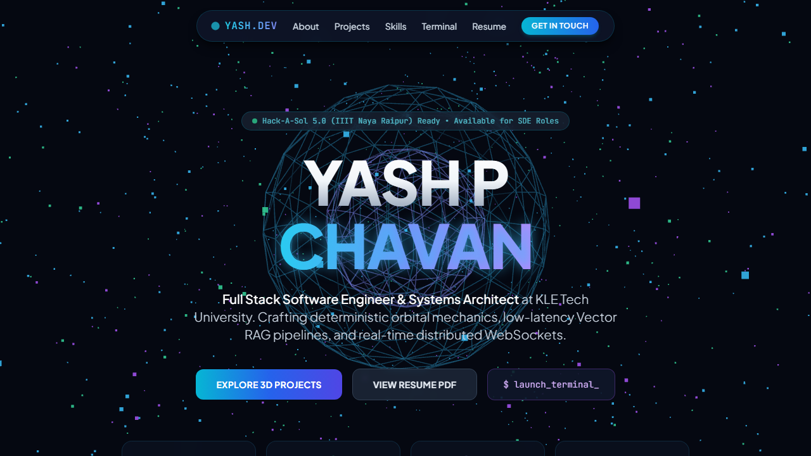

# 3D Space Developer Portfolio 🚀🌌

An interactive 3D WebGL space-themed engineering portfolio for **Yash P Chavan**, built with **Three.js (`r128`)**, **Tailwind CSS**, **Plus Jakarta Sans**, and **JetBrains Mono**.

---

## 📸 Preview & Live Walkthrough

### Interactive Viewport Screenshot


### Animated Demo


> 🎬 **[Watch Full Demo Video (WebM)](./docs/demo.webm)**

---

## 🌟 Highlights

- **Real-Time WebGL Starfield & Orbital Scene (`#webgl-bg`):** Three.js 3D particle starfield and geometric orbital visuals rendered behind a sleek obsidian/cockpit glassmorphic UI.
- **Interactive Simulation Modal (`#sim-modal`):** Launch interactive project detail views directly inside the portfolio viewport.
- **Built-In `Yash Shell v2.4` Terminal (`#terminal`):** Type commands like `skills` or explore capabilities interactively right inside the web app.
- **Zero Build Toolchain Required:** Single-file static web bundle (`index.html`) ready for instant preview or static hosting on GitHub Pages / Vercel.

---

## 🚀 Quick Start

```bash
# Open directly in any browser or serve locally with Python / Node:
npx serve .
# Visit http://localhost:3000
```

---

## 🛡️ License
MIT License. Built by [Yash P Chavan](https://github.com/Yash-Chavan-29).
